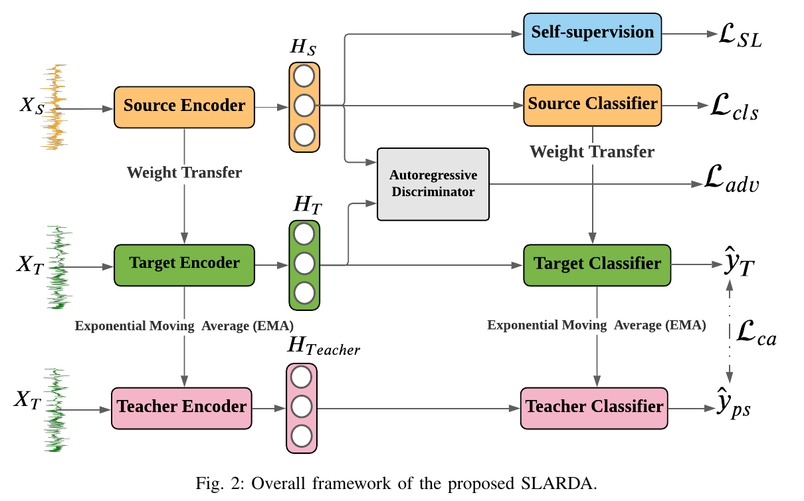
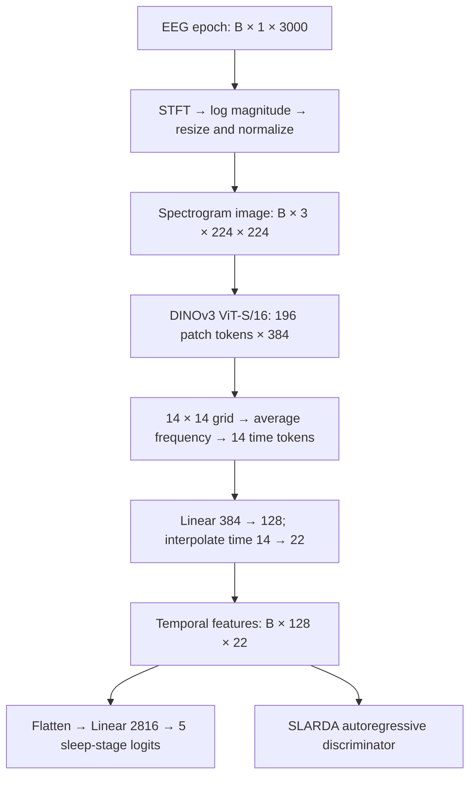

# SLARDA with a DINOv3 EEG Backbone

This research implementation replaces SLARDA's 1D CNN EEG encoder with **DINOv3 ViT-S/16 and an EEG spectrogram adapter**. It classifies a 30-second, single-channel EEG epoch into five sleep stages: W, N1, N2, N3 and REM. The adapter preserves SLARDA's feature interface so its classifier, temporal domain discriminator and teacher-based adaptation can consume the new representation.

The integration investigates whether image-pretrained features transfer to EEG. Correct tensor shapes and gradients establish that the components connect; they do not establish better sleep staging accuracy or reproduce the paper's results.

**Documentation updated:** 2026-10-30. **Repository branch:** `main`. **Maintainer:** [leetaan05](https://github.com/leetaan05). The published research files focus on EEG sleep staging. HAR and fault-diagnosis configuration/model files have been removed; legacy baseline classes remain inside shared modules.

**Contents:** [Architecture](#1-architecture) · [Encoder replacement](#2-how-the-encoder-is-replaced) · [Learning](#3-how-the-integrated-model-learns) · [Code map](#4-code-map) · [Environment](#5-environment-and-model-weights) · [Setup](#6-setup) · [Data](#7-data-contract) · [Run and verify](#8-run-and-verify) · [Troubleshooting](#9-troubleshooting) · [Limitations](#10-limitations-and-evaluation) · [References](#11-references-and-licenses)

## 1. Architecture

### Original SLARDA framework



*Figure 1. Figure 2 from Ragab et al., “Self-supervised Autoregressive Domain Adaptation for Time Series Data,” cropped from page 3 of the supplied paper. Source: [arXiv:2111.14834v2](https://arxiv.org/abs/2111.14834v2). Copyright 2022 IEEE. This figure describes the original method; it does not depict a DINOv3 experiment.*

SLARDA combines source representation learning, temporal domain alignment and confident teacher pseudo-labels. The replacement is inside the **encoder** blocks. A source model is learned first; its weights initialize the target model and teacher. During adaptation, the source model is frozen, the target model learns, and the teacher follows the target through an exponential moving average (EMA).

### Encoder path in this implementation



All of these operations run in the Python process on the selected CPU or GPU. Model weights and dataset tensors are loaded from disk. The research entrypoints are command-line programs.

## 2. How the encoder is replaced

### Why an adapter is needed

The original EEG CNN learns directly from `[B,1,3000]` waveforms. DINOv3 expects three-channel images. [`EEGToDINOv3`](SLARDA_DINOv3/dinov3_eeg.py) bridges these modalities and returns the same temporal feature dimensions as the EEG CNN. This preserves the classifier input and the GRU discriminator input while changing how those features are computed.

| Component | Original EEG path | DINOv3 EEG path |
| --- | --- | --- |
| Feature extractor | 1D convolutions over EEG | Spectrogram adapter + image-pretrained ViT-S/16 |
| Temporal feature tensor | `[B,128,22]` | `[B,128,22]` |
| Classifier | `Linear(2816,5)` | Same dimensions, newly trained parameters |
| Adaptation return value | `(logits, (flat, temporal))` | Same tuple layout |
| Temporal discriminator | Receives 128-channel sequences | Same input contract, different representations |
| Backbone optimization | CNN parameters can learn | DINOv3 parameters can learn; no backbone freeze in the adapter |
| Existing CNN checkpoints | CNN state dictionary | Incompatible with the DINOv3 model state dictionary |

Keeping an interface does not keep the predictions or feature statistics. Train a new DINOv3 source model before interpreting its adaptation results.

### Tensor walkthrough

[`EEGToDINOv3._spectrogram()`](SLARDA_DINOv3/dinov3_eeg.py) and [`EEGToDINOv3.forward()`](SLARDA_DINOv3/dinov3_eeg.py) implement the following operations:

| Step | Operation | Output |
| --- | --- | --- |
| 1 | Require floating-point, single-channel, 3000-sample epochs | `[B,1,3000]` |
| 2 | Float32 STFT with a 256-point Hann window, hop 64 and PyTorch's default centered padding | Complex spectrum `[B,129,47]` |
| 3 | Compute `log1p(abs(spectrum))`; bilinear resize to 224 × 224 | `[B,1,224,224]` |
| 4 | Min-max scale each epoch with a denominator floor of `1e-6`; repeat the image across three channels | `[B,3,224,224]` |
| 5 | Normalize channels with mean `[0.485,0.456,0.406]` and std `[0.229,0.224,0.225]` | DINOv3 image input |
| 6 | Run ViT-S/16: one CLS token, four register tokens and 196 patch tokens | `[B,201,384]` |
| 7 | Discard the five prefix tokens and reshape patches into frequency × time order | `[B,14,14,384]` |
| 8 | Average the frequency axis, preserving left-to-right temporal order | `[B,14,384]` |
| 9 | Apply trainable `Linear(384,128)` and transpose | `[B,128,14]` |
| 10 | Linear interpolation to the CNN-compatible sequence length | `[B,128,22]` |

The core bridge is short:

```python
# Excerpt from EEGToDINOv3.forward(); patch prefix validation omitted here.
patches = tokens[:, prefix:].reshape(eeg.shape[0], grid, grid, -1)
timeline = patches.mean(dim=1)
features = self.project(timeline).transpose(1, 2)
return F.interpolate(features, size=FEATURE_STEPS,
                     mode="linear", align_corners=False)
```

The classifier wrapper flattens `[B,128,22]` to `[B,2816]`, then produces `[B,5]` raw logits. `argmax(dim=1)` yields class IDs in the order W/N1/N2/N3/REM. Apply softmax only when probabilities are needed; the training cross-entropy consumes logits.

Three repeated channels are still one EEG measurement. The adapter discards STFT phase, changes absolute amplitude information through per-epoch scaling and averages frequency details. Interpolation from 14 to 22 positions adds no new temporal information.

## 3. How the integrated model learns

### Adaptation entrypoint

[`train_CD.py`](SLARDA_DINOv3/Autorgressive_Adaptation/train_CD.py) selects `EEG_DINOv3_S`. [`trainer/SLARDA.py`](SLARDA_DINOv3/Autorgressive_Adaptation/trainer/SLARDA.py) builds source, target and teacher copies. If a DINOv3 source checkpoint is absent, [`trainer/source_only.py`](SLARDA_DINOv3/Autorgressive_Adaptation/trainer/source_only.py) trains one using labeled source epochs. All three models then load that source state.

Let `F` denote temporal features, `C` the classifier and `D` the discriminator. The main objectives are:

| Objective | Calculation | Parameters involved |
| --- | --- | --- |
| Source supervision | `CE(C_s(F_s(x_s)), y_s)` | Source DINOv3, projection and classifier during source training |
| Domain discrimination | `BCEWithLogits(D(concat(F_s,F_t).detach()), [1,0])` | Discriminator; features are detached for this loss |
| Target alignment | `BCEWithLogits(D(F_t), 1)` | Gradients reach target DINOv3 and projection |
| Confident pseudo-label classification | `CE(target_logits[mask], teacher_labels[mask])`, where `mask = max(softmax(teacher_logits)) > 0.9` | Target backbone, projection and classifier |
| Target total | `L_align + 0.1 * L_pseudo` | Target model, using Adam |
| Teacher update | `teacher = 0.996 * teacher + 0.004 * target` | EMA assignment; no teacher backpropagation |

If no pseudo-label exceeds the confidence threshold, its classification loss is zero. Source and teacher parameters are frozen during adaptation. The target backbone remains trainable, so this is **not a frozen feature-extraction experiment**. The code retains the original objectives rather than adding DINOv3's image-pretraining losses.

The inherited trainer also calls the discriminator optimizer a second time after target backward. Consequently, its optimizer behavior is not fully described by an idealized “one discriminator step, one target step” diagram. Review this behavior when designing controlled experiments; the encoder integration does not rewrite that trainer.

## 4. Code map

```text
SLARDA_DINOv3/
├── README.md
├── dinov3_eeg.py                 # Shared spectrogram adapter and checkpoint loader
├── requirements.txt
├── smoke_test.py                 # Synthetic EEG interface/gradient checks
├── docs/figures/slarda-framework.png
├── Autorgressive_Adaptation/     # Spelling retained from the upstream project
│   ├── args.py
│   ├── train_CD.py
│   ├── config_files/EEG_Configs.py
│   ├── dataloader/dataloader.py
│   ├── models/models.py          # EEG_DINOv3_S and domain discriminators
│   └── trainer/                  # Source supervision, SLARDA, evaluation
```

The principal encoder change is [`dinov3_eeg.py`](SLARDA_DINOv3/dinov3_eeg.py), connected through the EEG model wrapper. Supporting changes in the copied adaptation code include domain discovery, empty pseudo-label handling and checkpoint/resume support. Those operational changes should be distinguished from the backbone substitution. The current workflow trains the source model with labels; it does not include a separate EEG CPC pretraining stage.

## 5. Environment and model weights

| Item | Reference / requirement |
| --- | --- |
| Local environment inspected | Windows; Python 3.13.9 |
| Installed core package metadata | PyTorch 2.14.1, torchvision 0.29.1, Transformers 5.20.1, safetensors 0.8.0, einops 0.8.2 |
| Dependency list | [`requirements.txt`](SLARDA_DINOv3/requirements.txt); it is not a complete version lock |
| Backbone | [`facebook/dinov3-vits16-pretrain-lvd1689m`](https://huggingface.co/facebook/dinov3-vits16-pretrain-lvd1689m), ViT-S/16, 384-dimensional patch tokens |
| Compute | CPU for the small smoke checks; CUDA recommended for research training |
| Memory | Adaptation constructs three ViT copies plus a discriminator; required RAM/VRAM depends on batch size and device and has not been benchmarked here |

The installed versions above describe the existing environment, not a guarantee for every operating system or a locked dependency resolution. The old upstream PyTorch 1.7 environment is unsuitable for this Transformers-based DINOv3 path.

Obtain authorized pretrained weights from the official model page. Two loading routes exist in [`dinov3_eeg.py`](SLARDA_DINOv3/dinov3_eeg.py):

1. **Raw Meta `.safetensors` file:** `_load_meta_safetensors()` converts the original key names into Transformers names, including splitting Q/K/V weights. It checks required keys and rejects incomplete conversions, allowing only the unused mask token to be missing.
2. **Transformers checkpoint directory or model ID:** `DINOv3ViTModel.from_pretrained(model_id)` handles that format. A remote ID may need network access and Hugging Face authentication; a local directory needs its configuration and model files.

Both training configs use `DINOV3_MODEL_PATH` when set. Otherwise they resolve `model.safetensors` at the repository root, one level above `SLARDA_DINOv3/`. The raw file and a Transformers-exported `model.safetensors` are different formats; use the whole directory for the latter. Only a 384-dimensional, RGB, patch-size-16 backbone is accepted.

## 6. Setup

Run the following in **Windows PowerShell**. Clone the research branch explicitly because the repository's default branch may be the web deployment branch.

```powershell
git clone --branch main --single-branch https://github.com/leetaan05/SleepcareAI.git
cd SleepcareAI/SLARDA_DINOv3
python -m venv .venv
.\.venv\Scripts\python.exe -m pip install --upgrade pip
.\.venv\Scripts\python.exe -m pip install -r requirements.txt
.\.venv\Scripts\python.exe -m pip check
```

Expected: `.venv/` exists, installation succeeds, and `pip check` reports `No broken requirements found.` For CUDA, install a matching PyTorch/torchvision build using the [official PyTorch instructions](https://pytorch.org/get-started/locally/) before running GPU training.

For Bash on Linux, the equivalent environment commands are:

```bash
python3 -m venv .venv
.venv/bin/python -m pip install --upgrade pip
.venv/bin/python -m pip install -r requirements.txt
.venv/bin/python -m pip check
```

Subsequent examples use Windows executable paths. On Linux, replace `..\.venv\Scripts\python.exe` with `../.venv/bin/python`, or `.\.venv\Scripts\python.exe` with `.venv/bin/python` as appropriate. Linux execution was not validated in this documentation update.

For pretrained training, set the checkpoint path in the **same PowerShell session**, replacing this example with a real absolute path:

```powershell
$env:DINOV3_MODEL_PATH = 'D:\models\dinov3-vits16-raw.safetensors'
Test-Path -LiteralPath $env:DINOV3_MODEL_PATH
```

Expected: `True`. Alternatively, point the variable to a compatible Transformers checkpoint directory. Both training configs default to `dinov3_pretrained=True`; loading errors are not silently replaced with random weights. The smoke checks below explicitly request random initialization unless `--pretrained` is passed.

## 7. Data contract

Prepare data before launching research training; dataset tensors are not distributed in this repository. Both entrypoints read:

```text
SLARDA_DINOv3/Autorgressive_Adaptation/data/EEG/
├── train_a.pt
├── val_a.pt
├── test_a.pt
├── train_b.pt
├── val_b.pt
└── test_b.pt
```

Each file must be a `torch.save()` dictionary with tensor values:

```python
{
    "samples": torch.Tensor,  # float32 [N, 1, 3000]
    "labels": torch.Tensor,   # int64 [N], values 0..4
}
```

The intended Sleep-EDF preparation uses `EEG Fpz-Cz` at 100 Hz, aligns PSG and hypnogram annotations, cuts 30-second epochs, maps W/N1/N2/N3+N4/REM to 0/1/2/3/4, removes unknown/movement epochs and applies per-epoch z-score normalization. Split subjects before producing the train/validation/test files to avoid sharing a person's epochs across splits. This EEG normalization precedes the adapter's spectrogram min-max scaling.

For the local workspace convention, `a` represents sleep-cassette and `b` sleep-telemetry. Public source data and acquisition conditions are described by [PhysioNet Sleep-EDF Expanded](https://physionet.org/content/sleep-edfx/). Access to raw EDF files alone is not enough: convert them to the tensor contract above first.

Domain discovery currently reads a **single character** after `train_`. Use IDs such as `a` and `b`, and provide matching validation/test files. At least two domains are needed for adaptation. The training loader drops incomplete batches, so each training split must contain at least one full configured batch; validation also needs a full half-batch.

## 8. Run and verify

### A. Check the integration without datasets or pretrained weights

Working directory: `SLARDA_DINOv3/`. Run each command in its own process because the two training trees both define modules named `args` and `models`.

```powershell
.\.venv\Scripts\python.exe smoke_test.py adaptation
```

Expected final lines:

```text
adaptation logits (2, 5) temporal (2, 128, 22) classification forward/backward OK
```

The check asserts the flattened shape `(2,2816)`, gradients in the projection and backbone, and a `(2,1)` GRU discriminator output with gradients in its output layer. Inputs are synthetic EEG and weights are random, so no accuracy claim follows from passing this check. It does not check a complete optimizer update or checkpoint round trip.

To also exercise pretrained loading, first configure the checkpoint path as above, then run:

```powershell
.\.venv\Scripts\python.exe smoke_test.py adaptation --pretrained
```

Expected: the same adaptation shape/gradient success line, after loading the supplied weights.

### B. Run supervised-source training and SLARDA adaptation

Working directory: `SLARDA_DINOv3/Autorgressive_Adaptation/`. This starts a real research training run and requires the dataset and pretrained weights.

```powershell
cd Autorgressive_Adaptation
..\.venv\Scripts\python.exe train_CD.py --device cuda --selected_dataset EEG --base_model EEG_DINOv3_S --da_method SLARDA --num_runs 3 --checkpoint_dir checkpoints --resume
```

Use `--device cpu` to select CPU. By default, the script evaluates every ordered pair of different discovered domains and seeds the runs with their run IDs (`0,1,2` for three runs). Missing source checkpoints trigger source-supervised training. The separate `--seed` argument does not replace this run-ID seeding in `main_train_cd()`.

| Configuration | Current default |
| --- | --- |
| Adaptation batch size / epochs | 8 / 15 |
| Source-supervised epochs / learning rate | 25 / `3e-4` |
| Target / discriminator Adam learning rates | `1e-3` / `1e-3` |
| Target StepLR | Step 10, gamma 0.1 |
| Pseudo-label threshold / weight | Strictly greater than 0.9 / 0.1 |
| Teacher EMA momentum | 0.996 |
| Discriminator | GRU, hidden dimension 512 |

Edit [`Autorgressive_Adaptation/config_files/EEG_Configs.py`](SLARDA_DINOv3/Autorgressive_Adaptation/config_files/EEG_Configs.py) to change these values. The active loader uses the outer `Config.batch_size=8`; the nested supervised batch setting does not rebuild the already-created loaders.

Expected progress includes `Source: a ---> Target: b`, a run ID, epoch/loss reports and `Saved resumable adaptation checkpoint:`. Outputs are written relative to the adaptation directory:

```text
src_only_saved_models/EEG/last_EEG_EEG_DINOv3_S_src_a.pt
checkpoints/EEG/EEG_DINOv3_S/source_only/src_a_progress.pt
checkpoints/EEG/EEG_DINOv3_S/a_to_b/run_0/last.pt
experiments_logs/Proposed/SLARDA_EEG_*/  # Logs and result spreadsheets
```

The adaptation checkpoint contains the target, teacher, discriminator, optimizer and scheduler states and completed epoch. `--resume` resumes from an existing progress checkpoint; completed source weights may be reused. Final test evaluation compares source-only and adapted models. These are expected artifacts of a completed run, not results supplied by this README.

## 9. Troubleshooting

| Symptom | Check / action |
| --- | --- |
| `DINOv3ViTModel` cannot be imported | Use the intended virtual environment and a Transformers release with DINOv3 support; inspect its version and reinstall the requirements. |
| `ModuleNotFoundError: einops` or another dependency | Run `python -m pip install -r requirements.txt` with the virtual environment's Python from `SLARDA_DINOv3/`. |
| Missing weights, invalid model ID, or missing `config.json` | Check `DINOV3_MODEL_PATH`. Use a raw Meta file for key conversion, or the complete Transformers directory for `from_pretrained()`. |
| Gated model access fails | Obtain access through the official model page and authenticate, or provide authorized local files. |
| Missing `data/EEG` or `train_a.pt` | Place all six tensors at the documented location; run the training script from its own branch directory. |
| `Expected EEG [B, 1, 3000]` | Convert to single-channel float EEG epochs with exactly 3000 samples. |
| No adaptation pairs / empty loader | Use two single-character domain IDs and sufficient samples for a complete configured batch. |
| CUDA unavailable / out of memory | Select `--device cpu`, or install a matching CUDA build and reduce the outer batch size in `EEG_Configs.py` (keep it at least 2 for the validation loader). |
| State-dictionary mismatch with a CNN checkpoint | Keep DINOv3 checkpoints separate and train a DINOv3 source model; renaming CNN weights does not convert the architecture. |
| Imports select the wrong `args` or `models` | Run the two entrypoints in separate Python processes from their documented working directories. |

## 10. Limitations and evaluation

The existing synthetic smoke checks define the interface checks described above. During this documentation update, a local smoke invocation produced no output and was stopped; a fresh runtime pass is therefore unconfirmed. The documentation was checked against source code and for valid local links. Complete research training, pretrained-weight provenance across machines, checkpoint interoperability between branches and an EEG accuracy improvement have not been established by this update. Local training logs are not presented as a controlled benchmark.

The image-to-EEG modality gap, amplitude/phase information loss, frequency averaging and noncausal attention all affect what the model can learn. Source, target and teacher copies also increase compute and memory requirements. The inherited training/evaluation behavior requires review before claiming a strict reproduction of the SLARDA paper.

A meaningful comparison with the CNN baseline should use identical subject splits, preprocessing, domain pairs and seeds, reserve test data for final evaluation, and report accuracy, macro-F1, per-class F1, Cohen's kappa and compute/memory costs. Record dependency versions, checkpoint origin and config values with the results.

## 11. References and licenses

- **Original method:** Ragab et al., [Self-supervised Autoregressive Domain Adaptation for Time Series Data](https://arxiv.org/abs/2111.14834v2); [official SLARDA code](https://github.com/mohamedr002/SLARDA).
- **Backbone:** [Meta DINOv3](https://github.com/facebookresearch/dinov3), [official model card](https://huggingface.co/facebook/dinov3-vits16-pretrain-lvd1689m), and [Transformers DINOv3 documentation](https://huggingface.co/docs/transformers/model_doc/dinov3).
- **README presentation reference:** [DeepSatModels-DINOv3](https://github.com/loanhviet/DeepSatModels-DINOv3), for its architecture, code mapping and verification walkthrough. Its satellite-specific adapters and frozen-backbone choices are not this EEG implementation.
- **Code license:** the inherited adaptation tree retains its [MIT license](SLARDA_DINOv3/Autorgressive_Adaptation/LICENSE). DINOv3 weights have their [own license terms](https://github.com/facebookresearch/dinov3/blob/main/LICENSE.md). The paper figure retains its original attribution and is not covered by the code's MIT license.
